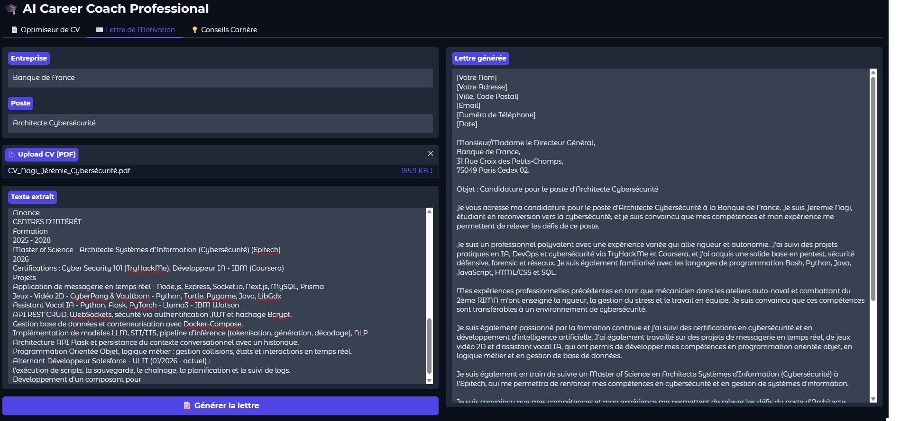

# AI Career Coach

A career assistant that reads a CV in PDF, tailors it to a job, writes a cover letter and answers career questions.

Guided project from the IBM AI Developer professional certificate.



## Features

| Tab | What it does |
| --- | --- |
| CV optimizer | Tailors the CV to the target position |
| Cover letter | Writes a letter for the company and the position |
| Career advice | Answers career questions |

The text of the CV is extracted from the PDF with `pypdf`, then sent to Llama 3.2 on IBM watsonx.ai. The interface is in French.

## Stack

Python · IBM watsonx.ai (Llama 3.2) · pypdf · Gradio

## Run it

You need an IBM watsonx.ai account.

```bash
git clone https://github.com/JN13012/AI-Career-Coach
cd AI-Career-Coach
pip install -r requirements.txt
```

Create a `.env` file:

```dotenv
WATSONX_URL=your_url
WATSONX_APIKEY=your_key
WATSONX_PROJECT_ID=your_project_id
```

Then start the app and open http://127.0.0.1:7860:

```bash
python3 app.py
```

## Limits

- The output of the model must be reread: it can state things that are not in the CV.
- This is a course project, not used in production.
